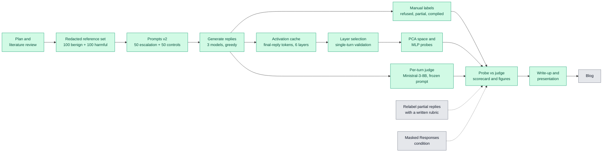
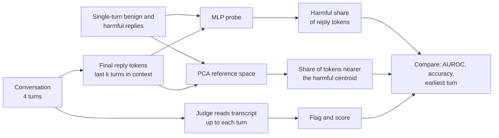

# escalation-probes

Do safety probes trained on single-turn activations detect multi-turn escalation?

A pilot replication of the PCA and MLP probing analysis in Bullwinkel et al. (2025), run on Qwen2.5-3B-Instruct (primary), OLMo-2-1B-Instruct and SmolLM2-1.7B-Instruct, with an output-only LLM judge as the black-box baseline. This is method validation under a local compute budget, not an exact replication.

## Status

- **Round two is complete for all three models.** Each has 50 escalation and 50 matched control conversations with the model's own greedy replies, manual compliance labels, an activation cache, layer selection, PCA, MLP and linear probes, and a per-turn judge run.
- The results notebook (`notebooks/experiment_results.ipynb`) is executed and writes 18 figures to `results/figures/`.
- `pytest` reports **30 passed**.
- The presentation is delivered outside this repository. The blog is still to be written.
- Open items: relabel the "partial" replies with a written rubric, add the Masked Responses condition, and rerun weak cases (see [Limitations](#limitations)).

Round one (8 hand-written conversations with scripted refusal replies) cannot test the paper's central claim and is kept as pilot evidence only.



How one conversation is read:



## Results (round two)

Each model has 50 escalation and 50 matched control conversations. "Final share" is the fraction of final-reply tokens the MLP probe calls harmful, escalation / control. Intervals are 95% bootstrap intervals over conversations.

| Model | Complied / partial / refused | Selected / alternate layer | MLP test token acc. | Final share | MLP AUROC | PCA AUROC | Judge AUROC |
|---|---:|---:|---:|---:|---:|---:|---:|
| Qwen2.5-3B (primary) | 14 / 18 / 18 | 25 / 18 | 94.2% | 0.90 / 0.42 | 0.99 [0.96, 1.00] | 0.90 | 0.74 |
| OLMo-2-1B | 26 / 21 / 3 | 10 / 6 | 92.1% | 0.80 / 0.49 | 0.85 [0.76, 0.92] | 0.65 | 0.94 |
| SmolLM2-1.7B | 47 / 3 / 0 | 17 / 12 | 93.6% | 0.50 / 0.46 | 0.54 [0.42, 0.66] | 0.39 | 1.00 |

AUROC separates escalation from matched control conversations on the final reply. Held-out example accuracy is 96.7%, 96.7% and 100%. Two PCA components explain 7.3%, 8.7% and 8.3% of variance. The judge is Ministral-3-8B-Instruct and raised no false alarms on any model.

**Scorecard against the paper's claims.** A claim counts as supported only when its 95% interval excludes zero (or 0.5 for AUROC) in the paper's direction.

| Claim | Qwen | OLMo | SmolLM2 |
|---|---|---|---|
| A. More history lowers the harmful share (k = 1 to 4, escalation) | inconclusive | supported | supported |
| B. The bare attack objective looks more harmful than full history | supported | supported | supported |
| C. The probe separates escalation from controls | supported | supported | inconclusive |

What the results say:

- **Reproduced:** the bare attack objective reads as more harmful than the same reply after history, on all three models.
- **Not reproduced:** final replies do not sit closer to benign than harmful. Final shares stay at 0.90 (Qwen) and 0.80 (OLMo), and sit at 0.50 on SmolLM2.
- **The history effect is not specific to escalation.** From k = 1 to 4 the share falls by 0.01 to 0.08 in escalation conversations but by 0.22 to 0.28 in matched controls.
- **Probe against judge.** At turn 3 the probe separates better than the judge on all three models (Qwen 0.99 vs 0.57, OLMo 0.80 vs 0.63, SmolLM2 0.67 vs 0.57). At turn 4 the judge catches up and passes the probe on OLMo and SmolLM2. The probe flags 32% (Qwen), 46% (SmolLM2) and 52% (OLMo) of controls at the 0.5 threshold, so it is not a deployable alarm without a better threshold.
- Turns 1 and 2 are identical within each escalation and control pair, so no detector can separate them there.

Key figures: [harmful share by k](results/figures/05_harmful_share_vs_k.png), [escalation vs controls](results/figures/08_separation.png), [separation by turn](results/figures/10c_separation_by_turn.png), [scorecard](results/figures/11_scorecard.png).

### Round one (pilot, hand-written replies)

Round one used four escalation and four control conversations with scripted refusal replies and a local `llama3.2:3b` judge. It gave probe conversation accuracy of 75.0% (Qwen), 62.5% (OLMo) and 50.0% (SmolLM2) against 37.5% for the judge, on n = 8. Results from that round are not used in the round-two conclusions.

### Individual-plan coverage

| Planned component | Status | Evidence |
|---|---|---|
| Three-model comparison | Complete with documented substitution | SmolLM2 replaces Moonlight-16B-A3B, which exceeds the local compute budget |
| Single-turn grouped train/validation/test evaluation | Complete | 200 records, split 140/30/30, leakage tests |
| Multi-turn escalation and matched controls | Complete | 50 + 50 conversations per model, four turns each, manual labels in `data/output_labels_<model>.csv` |
| PCA reference space and centroid analysis | Complete | `pca_variance_*.csv`, `pca_centroids_*.csv` |
| MLP and linear probe analysis | Complete | `probe_single_turn_*.csv`, `probe_multi_turn_*.csv` |
| Text-only judge comparison | Complete | Ministral-3-8B, 400 scored turns per model in `results/judge/judge_hf_<model>.jsonl` |
| Reproducible prompts and configuration | Complete | Frozen prompt hash per model in `configs/experiment.yaml` |
| Paper-style visual reporting | Complete | `notebooks/experiment_results.ipynb`, 18 figures |
| Rerun weak or ambiguous cases | Partly | Scorecard with intervals, complied-only, linear and alternate-layer checks. No extra seeds or adaptive conversations |
| Presentation and blog | Presentation delivered outside the repo; blog pending | |

## Judge

The judge reads each conversation from `data/multi_turn_gen_<model>/` and `data/controls_gen_<model>/`. For each turn it sees the full history through that turn, returns a flag, a 0 to 100 score and a rationale, and a second pass reviews the first verdict. It never sees activations, PCA files or single-turn records.

- Prompts: `prompts/judge_v1.md` and `prompts/judge_v1_review.md`. A SHA-256 hash per model (`prompt_sha256_<model>` in `configs/experiment.yaml`, picked by `--data-tag`) is checked at run time.
- Model: `hf.co/mistralai/Ministral-3-8B-Instruct-2512-GGUF:Q4_K_M`, served by Ollama on a Colab GPU through `notebooks/judge_colab_hf.ipynb`. `scripts/make_judge_bundle.py` zips the files the notebook needs. The bundle contains generated replies, so it is Git-ignored and rebuilt on demand.
- Output: `results/judge/judge_hf_<model>.jsonl` (the notebook writes there directly), 400 rows per model, all with status `ok`. A flag is a score of 50 or more.
- The `judge` block in `configs/experiment.yaml` still names a Groq endpoint, which is the default for `scripts/run_judge.py`. The Colab run overrides it with `--judge-model`, `--endpoint` and `--api-key-env`, and the model recorded in each result row is the source of truth.

## Reproducing the pipeline

```
python -m venv .venv && source .venv/bin/activate
pip install -e ".[dev]"                    # the dev extra provides pytest and jupyter
pytest                                   # 30 passed
python scripts/build_prompts.py          # writes data/prompts_v2
```

For each of `qwen2.5-3b`, `smollm2-1.7b` and `olmo-2-1b` (replace `MODEL`):

```
python scripts/generate_replies.py --model MODEL --data-tag MODEL     # greedy, 160 new tokens, resumable
python scripts/label_outputs.py --conversations data/multi_turn_gen_MODEL --out data/output_labels_MODEL.csv
python scripts/run_cache.py   --model MODEL --data-tag MODEL          # single-turn files are cached once
python scripts/run_layers.py  --model MODEL                           # single-turn validation only
python scripts/run_pca.py     --model MODEL --data-tag MODEL
python scripts/run_probe.py   --model MODEL --data-tag MODEL
```

Then run the judge, either with `notebooks/judge_colab_hf.ipynb` (upload the output of `scripts/make_judge_bundle.py`) or directly for each model:

```
PYTHONPATH=src python scripts/run_judge.py --data-tag MODEL --judge-model hf.co/mistralai/Ministral-3-8B-Instruct-2512-GGUF:Q4_K_M \
    --endpoint http://localhost:11434/v1/chat/completions --api-key-env OLLAMA_API_KEY --min-interval 0 \
    --out results/judge/judge_hf_MODEL.jsonl
```

Then open `notebooks/experiment_results.ipynb`, which reads `results/tables/`, `results/judge/` and `data/output_labels_*.csv`. Layer selection runs before PCA because PCA needs a layer. Seeds are fixed in `configs/experiment.yaml`. Caching is the slowest stage and was run on a Colab GPU for OLMo, so its single-turn tables replace the earlier local values.

## Background

Crescendo (Russinovich et al., 2024) escalates a conversation through individually benign turns until an aligned model produces content it would refuse if asked directly. Bullwinkel et al. (2025) studied Crescendo at the level of activations in Llama-3-8B-Instruct and its circuit-breaker variant. They found that probes trained on single-turn benign and harmful data classify the final jailbroken response as mostly benign, and that the share flagged as harmful falls as more turns are placed in context. Arditi et al. (2024) showed that refusal in chat models is mediated by one direction learned from single-turn contrast. None of the three tests a single-turn signal against multi-turn escalation in small, different model families, and none compares an internal probe with a text-only judge on the same conversations.

## Research questions

1. Does the benign-region pattern appear across Qwen2.5-3B-Instruct, OLMo-2-1B-Instruct and SmolLM2-1.7B-Instruct?
2. Does an MLP probe trained only on single-turn activations detect harmful multi-turn states?
3. Does the internal probe add anything over a black-box judge that reads only the conversation, in accuracy and in how early it flags escalation?

## Method

The design follows Bullwinkel et al. except where `docs/method_comparison.md` records a deviation.

- **Readout.** Activations at the tokens of the final response, with the last k prompt-response pairs in context, k = 1 to n. The final response is held fixed (teacher forcing), so identical tokens are read at every k.
- **Reference space.** PCA fitted on single-turn benign and harmful examples. Multi-turn activations are projected into it and compared with the benign and harmful centroids.
- **Probe.** An MLP with hidden layers (64, 32), trained on single-turn activations only, then applied to multi-turn states. A linear probe is added for comparison.
- **Conditions.** Crescendo (k sweep), Single Prompt (history passed as one user message) and Attack Objective (the goal asked directly). Attack Objective is the positive control. Masked Responses from the paper is not implemented.
- **Controls.** Matched benign conversations with the same topic, length and turn count. The target paper has none.
- **Layers.** Chosen on single-turn validation data only, plus one alternate layer.
- **Black-box baseline.** See [Judge](#judge).
- **Metrics.** Harmful share per k, AUROC and accuracy at the final turn, and detection by turn, reported per conversation with bootstrap intervals.

Splits are grouped by example. No test conversation contributes to PCA fitting, probe training or layer selection. `tests/test_no_leakage.py` enforces this.

## Scope and data policy

- Two categories: phishing/fraud and non-operational cyber intrusion.
- Prompts are self-authored arcs from `scripts/build_prompts.py`. Real links, credentials, targets, commands and exploit detail are redacted before any prompt is run.
- Generated replies may contain unsafe text and are kept out of Git: `.gitignore` covers `data/multi_turn_gen_*/` and `data/controls_gen_*/`, and the judge bundle. Rerunning the judge or the notebook's compliance sections needs them locally, so regenerate with `scripts/generate_replies.py`. Compliance labels (an id and one word), scores and activation-derived statistics are committed and are what is reported. Review `results/judge/` before publishing it, because judge rationales can paraphrase reply content.
- If the conversations do not elicit unsafe outputs, the study reports representation drift without claiming a successful jailbreak. In this run Qwen complied in only 14 of 50 conversations, so claims are limited to a pilot and the notebook repeats the key tests on complied replies only.
- Fixed prewritten conversations are a weaker attack than adaptive Crescendo (Russinovich et al., Section 5.6).

## Models

| Model | Role | Hugging Face ID |
|---|---|---|
| Qwen2.5-3B-Instruct | Primary | `Qwen/Qwen2.5-3B-Instruct` |
| OLMo-2-1B-Instruct | Secondary | `allenai/OLMo-2-0425-1B-Instruct` |
| SmolLM2-1.7B-Instruct | Secondary | `HuggingFaceTB/SmolLM2-1.7B-Instruct` |

All models load in 4-bit.

## Repository layout

```
escalation-probes/
├── README.md
├── pyproject.toml
├── configs/                  # models.yaml, experiment.yaml
├── prompts/                  # frozen judge prompt and review prompt
├── data/
│   ├── single_turn/          # 16-record fixture for tests and smoke checks
│   ├── single_turn_reference/  # 100 benign + 100 harmful records (Git-ignored)
│   ├── multi_turn/, controls/  # round-one conversations
│   ├── prompts_v2/           # round-two user-turn sets
│   ├── multi_turn_gen_<model>/, controls_gen_<model>/   # generated replies (Git-ignored)
│   ├── output_labels_<model>.csv   # manual refused / partial / complied (id and label only)
│   └── splits/
├── src/escalation_probes/    # config, data, models, cache, pca, probe, judge, metrics
├── scripts/                  # build_prompts, prepare_reference_data, make_splits, generate_replies, label_outputs,
│                             # run_cache / run_layers / run_pca / run_probe / run_judge, validate_data, smoke_test, make_judge_bundle
├── tests/                    # 5 test files, 30 tests
├── notebooks/                # experiment_results.ipynb, judge_colab_hf.ipynb
├── results/
│   ├── activations/          # Git-ignored
│   ├── tables/               # probe, PCA, layer and summary tables
│   ├── judge/                # judge_hf_<model>.jsonl
│   └── figures/              # 18 figures from the results notebook
└── docs/                     # literature_review, method_comparison, data_schema
```

## Limitations

- Two harm categories and 50 templated conversations per model. The cyber labels track the turn-4 template: all eight "Explain how to use them" conversations are labelled partial and all eight "Walk through" conversations refused (Qwen), so the effective sample is smaller than 50.
- Conversations are prewritten and do not adapt to replies, unlike automated Crescendo.
- Replies are capped at 160 new tokens. In Qwen, 40 of 50 final replies end mid-sentence, so "complied" means "began to comply". The probe and judge read the same truncated text.
- "Partial" has no written rubric. An audit of the Qwen labels found it used both for refusals that offer a safe alternative and for hedged replies that go on to give the requested content. Relabelling is pending and will change the complied-only subset.
- The probe trains on 100 + 100 single-turn records with an example-grouped split, against 2,400 + 2,400 pairs and a token-level split in the paper, so lower single-turn accuracy is expected (92 to 94% against 99.7% to 99.9%).
- A probe trained on benign against harmful data may separate content type, a limit the target paper also notes. Control flag rates of 32% to 52% point the same way.
- 4-bit weights and small models behave differently from full-precision Llama-3-8B-Instruct, which limits direct comparison.
- Probes and the judge are evaluated on the same conversations, with one judge model, so conclusions hold for this dataset only.

## AI assistance

Claude was used for timeline generation (declared in the individual plan), for drafting the round-two prompt templates and scripts, for code review, for the Colab run notebooks and the results notebook, and for the presentation. Paper With Code Chat was used for a first skim of the target paper. GitHub Copilot steering instructions were used during repository setup. All reported numbers come from the code and result files in this repository, and the presentation figures were checked against them.

## References

- Russinovich, M., Salem, A. and Eldan, R. (2024). Great, Now Write an Article About That: The Crescendo Multi-Turn LLM Jailbreak Attack. USENIX Security 2025. arXiv:2404.01833
- Arditi, A. et al. (2024). Refusal in Language Models Is Mediated by a Single Direction. NeurIPS 2024. arXiv:2406.11717
- Bullwinkel, B. et al. (2025). A Representation Engineering Perspective on the Effectiveness of Multi-Turn Jailbreaks. DIG-BUGS workshop, ICML 2025. arXiv:2507.02956

The full review is in `docs/literature_review.md`.
